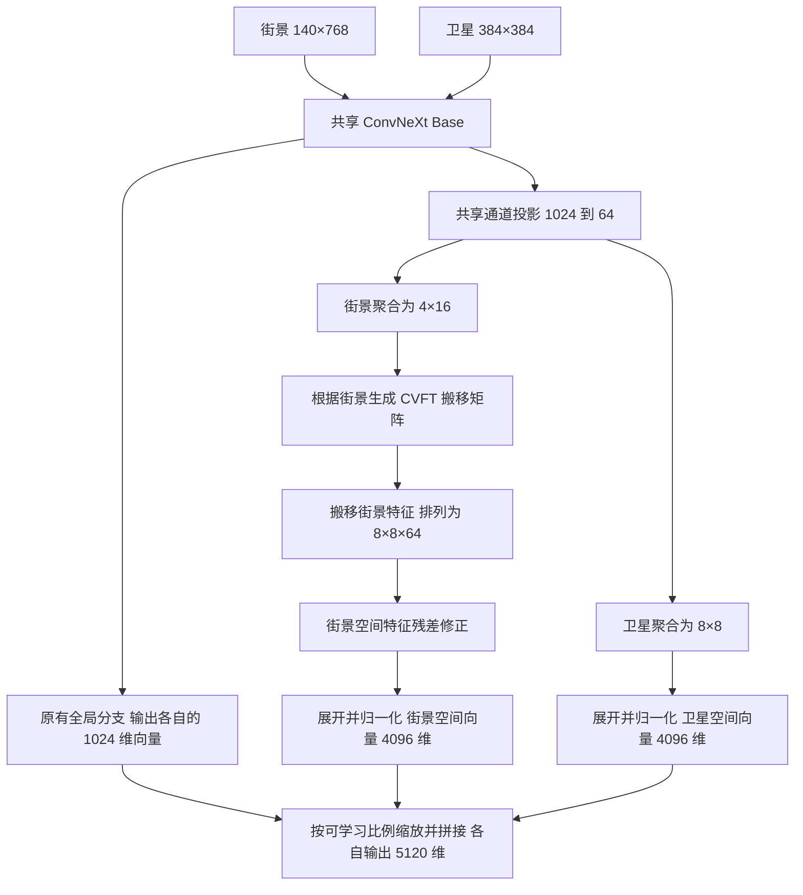

# CVDisaster Geo 特征映射与空间修正实验方案

日期：2026-11-11。

方案编号：`geo_cvft_refine`。

状态：模型、训练、评估、配置及验收代码已根据本方案更新，本地静态检查已通过。正在核验运行环境、存储空间和计算资源，随后执行计算节点验收及正式训练。

## 1 实验问题与比较对象

研究共享 ConvNeXt 提取的空间特征经过 CVFT 搬移和残差修正后，能否提高 CVIAN 街景到卫星图像的检索准确率。

比较对象固定为两种网络：

- `baseline`：当前已经复现的 CVDisaster Geo，使用共享 ConvNeXt 和全局检索向量。
- `geo_cvft_refine`：共享 ConvNeXt，同时输出全局特征与经过 CVFT 搬移、残差修正的空间特征，通过可学习比例组合成最终检索向量，使用该向量的 InfoNCE 共同训练。

本实验评价完整组合结构的效果。结论归属于整体网络，单个模块的贡献需要相应证据支持。

当前基线结果来自作业 `3979539`，训练提交为 `8ca60d598d2c306930b1b61d80c098ece846efeb`。保存的日志给出 R@1 为 79.8059%、R@5 为 97.8169%、R@10 为 98.9691%、R@1% 为 99.5149%。这些数值作为历史参考，正式比较使用相同训练随机种子的成对结果。

本地方案编写时的仓库提交为 `9f495dd79854026a6449e21d34a3d04cfc18d3f4`。未来实验记录填写实际训练代码提交号。

## 2 数据与监督信息

### 2.1 数据位置和内容

服务器原始数据目录为 `/scratch/liuzeyu/heyinxi/dataset/m1749324/CVIAN/`。

- 街景：`00_SVI/`，共 4,121 幅。
- 已有方向处理结果：`00_SVI_aligned/`。
- 卫星切图：`01_Satellite/`，共 4,121 幅。
- 位置记录：`02_Position/CVIAN_position.geojson`。

正确配对由图片 ID 确定。类别目录中的损伤标签用于数据完整性核验，geo 的损失函数只使用图片 ID 配对关系。

### 2.2 固定数据划分

两种网络共用已有 `train_60.csv` 和 `val_60.csv`：

- 训练：2,472 对唯一图片。
- 测试：1,649 对唯一图片。
- 划分方式：作者排序后的配对清单，使用 `train_test_split(train_size=0.6, random_state=42)`。
- 划分随机种子始终为 42，与训练随机种子分开记录。

核验两份清单的文件 SHA256、唯一 ID 数量、配对图片名称、类别目录、文件存在性，以及训练和测试之间的 ID 交集。清单及已有方向处理图像保持原样。

本实验沿用作者的训练和测试两部分评价协议。测试集同时用于每轮评价和最佳 checkpoint 选择，结果应按这一协议解释。

### 2.3 数据能够提供的监督

街景和卫星的图片配对监督网络学习检索特征。搬移矩阵通过检索损失学习，其空间位置表示网络内部的特征布局。矩阵中的数值不能直接解释成具有真实地面尺度的像素对应概率。

本结构的前向计算使用图像内容与图像内的空间顺序。相机高度、深度、逐像素对应和物体分割标签均不作为输入。卫星经纬度在检索出图片 ID 后用于输出位置。

## 3 图像输入与预处理

### 3.1 输入尺寸

沿用当前 geo 的图像处理过程，保证两种网络使用相同输入。

- 训练街景：读取 `00_SVI_aligned` 图像，保留行区间 `[160:350]`，随后缩放到高 140、宽 768。
- 评估街景：读取相同方向处理结果，保留 `[160:360]`，随后缩放到高 140、宽 768。
- 卫星：读取完整切图，缩放到高 384、宽 384。
- 图像通道顺序：RGB。
- 缩放插值：沿用 `cv2.INTER_LINEAR_EXACT`。
- 归一化：使用现有模型的 `get_config` 返回值，并保存实际 mean、std 和数据配置。

训练与评估街景裁剪区间的上述差别来自当前基线，本次结构比较沿用这一处理规则。

### 3.2 训练增强

增强顺序及概率沿用当前 Dataset 与 transforms：

1. 图片对以 0.5 的概率同时水平翻转。
2. 各视角以 0.5 的概率进行质量 90 至 100 的图像压缩增强。
3. 缩放到对应网络输入尺寸。
4. 各视角以 0.5 的概率执行 ColorJitter，brightness、contrast、saturation、hue 参数均为 0.15。
5. 各视角以 0.3 的概率执行 AdvancedBlur 或 Sharpen。
6. 各视角以 0.3 的概率执行 GridDropout 或 CoarseDropout。卫星 GridDropout 的 ratio 为 0.4，街景为 0.5；CoarseDropout 的具体参数沿用原 transforms，并记录配置。
7. 归一化并转换为 tensor。
8. 图片对以 0.75 的概率执行对应旋转：卫星旋转 90、180 或 270 度，街景在水平方向进行对应的周期移动。

颜色、压缩和遮挡增强分别采样；图片对的翻转与方向变化保持关联。评估使用确定性的裁剪、缩放和归一化。

## 4 网络结构

### 4.1 共享编码器与两个输出分支

backbone 固定为 `convnext_base.fb_in22k_ft_in1k_384`。街景与卫星调用同一个 ConvNeXt 实例，共享全部 backbone 参数。

通过 `forward_features` 取得最后一个 stage 的空间特征，再通过原有 `forward_head` 取得全局向量。同一次图像编码产生的空间特征同时服务于全局分支和空间分支。

### 4.2 空间 tensor 的形状

使用 `B` 表示图片对数量，`d=64` 表示空间分支的通道数量。

根据当前输入尺寸和 ConvNeXt 的下采样规则，预期空间特征为：

- 街景 `F_g`：`[B, 1024, 4, 24]`。
- 卫星 `F_s`：`[B, 1024, 12, 12]`。

这两项形状在实现验收时使用真实 CVIAN 图片核对。

共享 `Conv2d(1024, 64, kernel_size=1, bias=True)` 完成通道投影。随后分别使用 `AdaptiveAvgPool2d((4,16))` 和 `AdaptiveAvgPool2d((8,8))` 聚合位置。按行优先顺序展开为：

\[
G\in\mathbb{R}^{B\times64\times64},\qquad
S\in\mathbb{R}^{B\times64\times64}.
\]

第二维为空间位置，第三维为特征通道。街景源位置索引采用 `i=row*16+column`，卫星目标位置索引采用 `j=row*8+column`。

### 4.3 全局分支

全局分支沿用现有 `forward_head`，保持原有 pooling 与归一化层的顺序，输出 `[B,1024]`。按第 7 节的规则进行 L2 归一化，得到 `u_g` 和 `u_s`。

共享编码器接收两个分支的训练梯度。因此，组合模型训练后的全局特征也可能改变，其评价结果需要由训练后的 checkpoint 计算。

## 5 CVFT 特征搬移

### 5.1 代价矩阵生成

矩阵生成模块只接收街景的 64 通道、4×16 空间特征：

1. 使用 `Conv2d(64,1,kernel_size=1,bias=True)` 压缩通道。
2. 使用 GELU。
3. 按街景源位置顺序展开为 `[B,64]`。
4. 使用 `Linear(64,4096,bias=True)` 生成矩阵数值。
5. reshape 为代价矩阵 `C(g)`，形状为 `[B,64,64]`。

矩阵的行对应街景源位置，列对应目标网格位置。每幅街景独立生成自己的矩阵；同一矩阵应用于该图像的全部 64 个通道。

新增 Conv 和 Linear 使用 Xavier uniform 初始化，bias 初始化为零。原预训练模型的 backbone 和全局 head 参数按 checkpoint 原值加载。

### 5.2 Sinkhorn 计算

主配置固定：

- 温度 `transport_tau=1.0`。
- 行列归一化迭代次数 `sinkhorn_iterations=20`。
- 计算 dtype 为 FP32；在 AMP 训练中，该模块显式使用 FP32。
- 在对数域计算，初值 `log_P=-C(g)/transport_tau`。

每次迭代依次执行：

\[
\log P_{ij}\leftarrow\log P_{ij}
-\operatorname{logsumexp}_{k}(\log P_{ik}),
\]

\[
\log P_{ij}\leftarrow\log P_{ij}
-\operatorname{logsumexp}_{k}(\log P_{kj}).
\]

最后通过指数运算得到 `P`。这里采用各行和各列之和均约为 1 的双随机矩阵约定，矩阵总和约为 64。

每步核验矩阵的有限性、非负性和行列和误差。定义：

\[
e_{row}=\max_i\left|\sum_jP_{ij}-1\right|,
\qquad
e_{col}=\max_j\left|\sum_iP_{ij}-1\right|.
\]

容许误差固定为 `1e-3`。出现非有限值或误差超过阈值时就地报错，输出样本 ID、代价范围、行列误差及温度。迭代次数与温度的更改需要更新配置和方案，正式运行不自动改变计算规则。

### 5.3 特征搬移

对于每个样本，使用：

\[
\widetilde G=P^\top G.
\]

因此：

\[
\widetilde G_j=\sum_iP_{ij}G_i.
\]

`P` 的行列约定与上述乘法顺序保持一致。搬移输出形状为 `[B,64,64]`，按目标位置索引恢复为 `[B,64,8,8]`，交给空间特征修正模块。

最终卫星图片及其正确 ID 不参与预测时的街景矩阵生成。跨视角关系通过训练损失传入矩阵生成模块。

### 5.4 空间顺序的保留

对双随机矩阵有：

\[
\operatorname{mean}(P^\top G)=\operatorname{mean}(G).
\]

所以本结构保留目标网格顺序，最终展开空间特征。4×16 和 8×8 的自适应聚合发生在搬移之前，负责形成有限的位置集合。

记录每轮矩阵的平均行熵、最大元素、`e_row` 和 `e_col`。行熵为：

\[
H(P)=-\frac1{64}\sum_i\sum_jP_{ij}\log(P_{ij}+10^{-12}).
\]

接近均匀的矩阵可能过度混合位置，过度集中的矩阵也需要结合损失与测试表现判断。熵仅作为诊断量，主损失中不增加对应正则项。

## 6 空间特征修正

修正模块接收搬移后的街景特征 `X`，形状为 `[B,64,8,8]`，输出同形状 tensor：

\[
R(X)=X+\operatorname{Conv}_{3\times3}^{(2)}
\left(\operatorname{GELU}\left(
\operatorname{Conv}_{3\times3}^{(1)}(\operatorname{LN}_{channel}(X))
\right)\right).
\]

模块参数固定为：

- LayerNorm 对每个空间位置的 64 个通道计算，`eps=1e-6`，使用可学习的 scale 和 bias。
- 两个 Conv 均为 64 输入通道、64 输出通道、kernel size 3、stride 1、padding 1、`bias=True`。
- 中间激活为 GELU，第二个 Conv 后直接与输入相加。
- Conv 使用 Xavier uniform，bias 为零；LayerNorm scale 为 1、bias 为零。

该模块只作用于经过搬移的街景特征。卫星空间特征采用共享通道投影和 8×8 聚合后的输出。

CVFT 负责重新分配空间位置的特征，残差模块在目标网格上学习邻近位置和通道之间的进一步组合。修正输出在这一阶段仍然是 64 通道、8×8 的检索特征，其地理解释需要额外证据支持。

将 `R(X)` 与卫星空间特征分别按相同目标顺序展开为 `[B,4096]`，按第 7 节的规则进行 L2 归一化，得到 `v_g` 和 `v_s`。

## 7 最终输出与相似度

### 7.1 分支归一化与可学习比例

全局分支和空间分支的原始输出分别记为 `h` 和 `r`。每幅图像独立进行：

\[
u=\frac{h}{\|h\|_2},\qquad
v=\frac{r}{\|r\|_2}.
\]

范数沿特征维度计算，输出形状分别为 `[B,1024]` 和 `[B,4096]`。分支归一化采用 FP32，核验原始向量的有限性及非零范数，再使用 `eps=1e-12` 的 L2 归一化函数。图片之间、分支之间均不合并计算范数。

设置一个整个模型共用的可训练标量 `fusion_logit=a`：

\[
\alpha=\operatorname{sigmoid}(a),\qquad
w_{global}=\alpha,\quad w_{spatial}=1-\alpha.
\]

初始化 `a=0`，对应初始比例各为 0.5。街景、卫星、所有样本和所有候选共用这个比例。`a` 通过训练集最终检索损失的梯度更新，预测时使用所加载 checkpoint 内的数值。

### 7.2 缩放与拼接

对归一化分支使用权重平方根进行缩放：

\[
z_g=[\sqrt{\alpha}\,u_g;\sqrt{1-\alpha}\,v_g],\qquad
z_s=[\sqrt{\alpha}\,u_s;\sqrt{1-\alpha}\,v_s].
\]

最终向量维度为 5,120。由两个分支各自的单位范数得到：

\[
\|z\|_2^2=\alpha\|u\|_2^2+(1-\alpha)\|v\|_2^2=1.
\]

街景与卫星的相似度恰好为：

\[
s(g,s)=z_g^\top z_s
=\alpha u_g^\top u_s+(1-\alpha)v_g^\top v_s.
\]

平方根系数保证点积中的比例等于学习得到的 `alpha`。每个分支单独归一化，使维度数量与融合比例分别控制。训练、难负采样和预测使用同一拼接公式。

FP32 中通过 `exp(0.5*logsigmoid(a))` 与 `exp(0.5*logsigmoid(-a))` 计算两个缩放系数，保持数值计算与上述公式一致。融合参数使用与其他可训练参数相同的 optimizer 和参数衰减规则。记录 `a`、`alpha` 及其梯度，检查非有限值。

最终向量沿特征维度再次 L2 归一化，消除浮点计算中的范数误差；InfoNCE 和评估使用这一输出。归一化前后的向量及初始化比例均纳入数值核验。5,120 维 float32 向量组成的 1,649 张卫星候选库约占 32.2 MiB，此值只表示向量数据本身的存储量。

### 7.3 训练接口

训练样本输入为街景 tensor、卫星 tensor 和图片 ID。网络提供：

- `global_features`：各视角 `[B,1024]`。
- `spatial_features`：各视角 `[B,4096]`。
- `descriptors`：各视角 `[B,5120]`。
- `transport`：街景 `[B,64,64]`，用于搬移和诊断。
- `fusion_weight`：模型共用的标量 `alpha`，用于记录融合比例。

图片 ID 用于核验配对和 batch 唯一性，不作为模型的图像特征输入。

### 7.4 单幅图像预测接口

预测显式指定视角 `ground` 或 `satellite`。街景执行矩阵生成、搬移和修正，卫星执行通道投影及目标网格聚合。每幅图像独立输出一个 `[5120]` 检索向量。

测试时对 1,649 张卫星图像预先计算向量，街景向量与整个候选库计算相似度并排序。街景和卫星特征必须由同一 checkpoint 产生，使用其中同一个 `alpha`。候选缓存记录 checkpoint 标识与 `alpha`，重新加载其他 checkpoint 时重新生成对应缓存。

输出 Top-K 卫星 ID、经纬度、最终相似度、两个分支各自的相似度及融合比例。原始图片路径同时保留，供后续 est 实验关联。

## 8 训练损失与温度参数

沿用原作者双向 InfoNCE 的计算方式，输入为第 7 节输出的最终融合向量。对于全局 batch `B=64`，令：

\[
Z_g,Z_s\in\mathbb{R}^{B\times5120},\qquad
y_i=i,\quad i=0,\ldots,B-1.
\]

由一个共用的可训练 `logit_scale=ell` 生成 logits：

\[
M=\exp(\ell)Z_gZ_s^\top\in\mathbb{R}^{B\times B}.
\]

唯一训练目标为：

\[
L=\tfrac12\left[
\operatorname{CE}_{0.1}(M,y)
+\operatorname{CE}_{0.1}(M^\top,y)
\right].
\]

`CE_0.1` 为 label smoothing 0.1、`reduction=mean` 的 cross entropy。正样本为当前行对应的同 ID 卫星，其他 63 幅卫星作为 batch 内负候选；转置方向使用相同定义。baseline 将其最终 1,024 维向量传入同一损失函数。

`logit_scale` 从同一 CVUSA checkpoint 加载并参与训练，与作者原有参数含义一致。Sinkhorn 的 `transport_tau`、InfoNCE 的 `logit_scale` 和融合的 `fusion_logit` 各自承担不同作用，分别记录。

最终融合向量的梯度共同更新共享 ConvNeXt、原有全局 head、共享通道投影、矩阵生成模块、残差修正模块、`fusion_logit` 和 `logit_scale`。两个分支的单独相似度仅作诊断；总损失不附加分支独立损失。

两张 GPU 的最终融合向量汇集后计算 `[64,64]` logits，保持跨 GPU 的梯度连接。所有副本使用同一个逻辑上的 `fusion_logit` 和 `logit_scale`。梯度累积不能代替同一次 InfoNCE 中的负候选数量。

## 9 训练配置

### 9.1 环境和输入权重

- Conda 环境：`/scratch/liuzeyu/anaconda3/envs/cvdisaster_geoloc`。
- Python：3.10，实际补丁版本写入实验记录。
- PyTorch：`1.13.1+cu116`。
- torchvision：`0.14.1+cu116`。
- timm：`0.8.19.dev0`。
- 其他依赖沿用仓库的 `requirements.txt` 与 `requirements-geoloc.lock.txt`，运行时保存实际版本清单。
- 初始 CVUSA 权重：`/scratch/liuzeyu/heyinxi/pretrained/weights_e40_98.6830.pth`。
- 权重 SHA256：`739cf00d303836fba1195f1bb8d54c4b13c53926ce3212fc9ceced335fc59a23`。

两种网络从同一 CVUSA checkpoint 开始训练。组合模型逐项加载原有 backbone、全局 head 和 `logit_scale`；新增模块按本方案初始化，`fusion_logit` 初始化为零。检查缺失项和多余项，所有与原结构对应的参数必须完整加载。

### 9.2 优化参数

- GPU：两张 A100，保持当前全局 batch 设置。
- 全局训练 batch：64 对，每张 GPU 约 32 对。
- 全局评估 batch：128 幅。
- 训练轮数：10。
- 优化器：AdamW。
- 学习率：`5e-4`，backbone 和新增模块使用相同基础学习率。
- AdamW betas：`(0.9,0.999)`，eps：`1e-8`，weight decay：`0.01`，amsgrad：`False`。
- 参数衰减采用当前代码规则，不额外排除特定参数。
- AMP：启用；GradScaler 初始 scale 为 `2**10`。
- 组合模型训练目标：最终融合向量的双向 InfoNCE；融合比例通过训练集反向传播学习。
- `fusion_logit` 初值为 0；其参数更新使用同一基础学习率与 weight decay。
- 梯度处理：AMP unscale 后，沿用逐元素梯度裁剪 `clip_grad_value_=100`。
- scheduler：cosine，预热长度 39 个优化步，总长度 390 个优化步。
- DataLoader workers：4。
- 不自动续训；每次完整实验独立初始化并保存输出。

### 9.3 自定义采样与调度计数

沿用当前训练集自定义采样，`custom_sampling=True`、`sim_sample=True`、`gps_sample=False`、`neighbour_select=64`、`neighbour_range=128`。

调度步数在第一次自定义采样之前确定。2,472 对数据和 batch 64 对应 39 批，因此预热 39 步、总调度 390 步。

当前采样方式每轮保留 2,432 对，形成 38 个完整 batch，实际训练共 380 个优化步。每轮剩余的 40 对由当轮采样规则确定。按实际顺序逐步调用 scheduler，记录每轮样本清单、优化步数和学习率。末轮按实际第 380 步所在位置结束。

两种网络分别按照自己的当前检索特征更新训练集难负候选；组合模型使用最终 5,120 维向量进行难负采样。该规则对应对完整检索系统的比较。

### 9.4 随机种子

固定划分 seed 42。训练 seed 使用 `42、43、44`，两种网络分别使用同一组 seed，共六次正式训练，仍然只有两个比较对象。

每次固定 Python、NumPy、PyTorch、CUDA 及 DataLoader 的随机生成来源，并记录 GPU、CUDA、cuDNN 和实际后端设置。保留当前基线的后端运行方式；seed 不能保证所有 GPU 算子逐位一致。

### 9.5 与作者实验的比较范围

直接改进幅度由同条件重新训练的 baseline 与组合模型计算。两种网络共用输入权重、划分清单、预处理、增强规则、全局 batch、GPU 数量、优化器、学习率、训练轮数、调度计数、评价频率、随机种子组及最佳权重选择规则。损失函数共用作者的双向 InfoNCE 和 label smoothing 0.1。

当前复现配置为全局 batch 64、LR `5e-4`、随机 6:4。作者公开训练入口默认全局 batch 128、LR `1e-3`，默认划分为 `subarea5`；项目记录的正式论文正文 LR 为 `1e-4`。实验报告分别列出作者论文、公开代码和本次统一训练设置。论文中的随机 6:4 表格提供背景参考，同条件 baseline 提供本次直接比较依据。

两个模型的结构、可训练参数量、向量维度、实际难负候选及计算量分别记录。使用同一训练规则进行完整模型比较，成绩变化的归因范围为完整组合结构。

## 10 评价与 checkpoint 选择

### 10.1 候选库与指标

测试查询为 `val_60.csv` 中的 1,649 张街景，卫星候选为同一清单中的 1,649 张卫星图像。图片 ID 决定唯一正确候选，全部测试查询进入评价。

两种模型共用一份评价入口和排名计算函数。提取最终向量后，统一转换为 FP32，再按特征维度执行 L2 归一化，采用 `eps=1e-12`，随后使用 FP32 矩阵乘法计算完整 `[1649,1649]` 相似度矩阵。该流程保持作者的单位向量点积与排名数学定义，实际数值与作者原 `predict`、`calculate_scores` 的一致性在运行验收中核对。

评价过程中每个模型只使用所选 checkpoint 的最终向量和参数。候选集合保持完整，测试街景的真实经纬度及损伤标签只用于结果关联或分析，不参与候选筛选或分数计算。融合比例仅由训练集优化，每轮测试不单独调整该比例。

每个完整训练轮次结束后，在测试集上计算最终检索向量的：

- 主指标：R@1。
- 辅助指标：R@5、R@10、R@1%。

沿用作者排名定义：某个查询的排名值为“相似度严格大于正确卫星相似度的候选数量”；排名值小于 K 时记为 R@K 命中。R@1% 的 K 使用 `floor(1649/100)=16`。

对于 `Q=1649` 个查询，统一报告百分比：

\[
rank_i=\sum_j\mathbf{1}[s_{ij}>s_{i,gt(i)}],\qquad
R@K=\frac{100}{Q}\sum_i\mathbf{1}[rank_i<K].
\]

输出 Top-K 清单时，分数相同的候选按固定卫星 ID 顺序排列，同时记录相同分数数量。上述清单排序与作者指标的相同分数处理分别保存定义。

### 10.2 最佳权重

每个完整训练轮次结束后评价一次。按最终组合向量的测试集 R@1 严格提高时保存 best，出现相同 R@1 时保留较早的 checkpoint。baseline 按其全局向量使用相同规则。

训练结束后重新加载该轮 best，在完整测试集上重新计算四项指标。最终 R@5、R@10 和 R@1% 均来自该 checkpoint。

另外保存训练结束权重及其训练状态，记录 optimizer、scheduler、GradScaler、已完成轮次和优化步数。checkpoint 必须保存融合参数、共用 `logit_scale` 和模型结构配置。最佳权重与最后一轮权重在文件名和元数据中明确区分。

### 10.3 成对比较

对于每个 seed，计算组合模型与 baseline 的 R@1 百分点差，再报告两种模型各自的均值、样本标准差，以及三个成对差值。历史作业 `3979539` 单独列为参考结果。

在同一测试 ID 清单上统计：

- baseline 错误、组合模型正确的数量。
- baseline 正确、组合模型错误的数量。
- 两种模型同时正确、同时错误的数量。

组合模型的全局分支和空间分支在最终 best checkpoint 上输出诊断指标，不额外选择各分支自己的最佳权重。结论依据完整模型的最终向量与对应统计。

记录预测耗时、峰值 GPU 显存及特征维度。网络容量、向量维度、可学习融合和采样结果的变化均属于整体结构变化，比较结果不单独归因于 CVFT 或残差模块。

## 11 实现和运行验收

以下检查规定更新后结构的实现验收要求，使用真实数据在计算节点执行。

1. 使用真实 CVIAN 图片核对预处理尺寸、空间特征形状、4×16 和 8×8 的展平及恢复顺序。
2. 使用真实训练 batch 检查 batch 内 ID 唯一性、同 ID 配对、两张 GPU 特征汇集及 64×64 InfoNCE logits。
3. 检查矩阵生成只依赖街景，卫星候选向量能够逐幅独立计算。
4. 检查 Sinkhorn 的 dtype、非负性、有限性、行列和，以及 `P^T G` 的索引方向。
5. 使用实际模型输出检查均值保持关系，验证搬移与展开保留的空间顺序。
6. 检查全局向量、空间向量和组合向量的范数，零范数和非有限值直接报错。
7. 使用实际前向输出验证平方根缩放、组合向量单位范数，以及组合向量点积等于 `alpha` 加权的两分支相似度之和。覆盖初始化与实际参数更新后的融合比例。
8. 执行真实 batch 的前向、反向和参数更新，确认共享 backbone、通道投影、矩阵生成、修正模块、`fusion_logit` 及共用 `logit_scale` 均获得有限且有效的梯度；同时核对唯一训练损失确实读取最终融合向量。
9. 在两张实际 GPU 上验证正式输入和完整 batch 的显存与主机内存，记录实际峰值。资源不足时停止并修订资源或配置，不静默改变 batch。
10. 保存并加载真实模型权重，核对融合参数、同一输入的预测、完整测试 ID 关联，以及候选缓存和 checkpoint 的一致性。
11. 训练、推理和较大规模特征计算通过 Slurm 在计算节点进行。正式运行使用离线数据与已有权重。
12. 使用同一个 baseline checkpoint 和完整真实测试集，分别执行作者评价流程和共用评价流程。核对查询与候选 ID 顺序、实际 tensor dtype、相似度误差、每个查询的正确候选排名及四项 Recall。相似度计算的最大绝对误差容许值为 `1e-5`，排名及 Recall 必须一致；发现差异时查明精度或处理顺序原因，在形成比较结果之前完成核验。

## 12 文件组织与实验记录

模型、Dataset、训练入口、评估入口和配置均安排在 `ME CVDisaster/` 内。基线来源保存在 `Author CVDisaster/`，组合模型实现独立管理。

训练输出使用服务器仓库外的独立目录，每次运行按模型名称、seed 和 JobID 标识。记录至少包含：

- 训练代码提交号、方案编号、完整启动参数与实际 Slurm 脚本。
- 环境、硬件、输入权重 SHA256、划分文件 SHA256。
- 实际图像处理参数、训练 seed、采样配置和每轮样本 ID。
- 最终融合向量的 InfoNCE 损失、共用 `logit_scale`、学习率与优化步数。
- `fusion_logit`、`alpha`、其梯度与 checkpoint 中保存的最终融合比例。
- Sinkhorn 误差、矩阵行熵和最大元素，以及梯度有限性检查结果。
- best 和训练结束 checkpoint，保存与加载核验结果。
- 每轮测试指标、best 对应的完整逐查询预测与正确候选排名。
- 训练时间、预测时间、GPU 显存和主机内存。
- 两种模型的成对比较结果、作者评价一致性检查及异常说明。

JobID、实际输出路径、命令及成绩在实施和运行后写入实验记录。当前方案不预填未来运行结果。

## 13 方法依据

- CVFT：学习图像相关的搬移矩阵、Sinkhorn 计算及空间特征展开。参考 [Optimal Feature Transport for Cross-View Image Geo-Localization](https://arxiv.org/html/1907.05021) 和 [作者核心实现](https://raw.githubusercontent.com/YujiaoShi/cross_view_localization_CVFT/ddf6c2f6d35c0103b9315d686a3135a1a09db5fd/script/ot_net.py)。
- DenseFlow：投影或搬移后，通过残差模块进一步处理空间特征的思路。参考 [Learning Dense Flow Field for Highly-accurate Cross-view Camera Localization](https://arxiv.org/abs/2309.15556)。本方案的 64 通道残差模块按本模型的 8×8 网格设计。
- 现有 geo：共享 ConvNeXt、CVUSA 预训练、图像预处理、InfoNCE、难负采样及评价规则。对应仓库中的 `Author CVDisaster/geolocalization/` 与 `slurm/train_geoloc.sbatch`。

4×16 街景源网格、8×8 卫星目标网格、5,120 维组合向量、可学习融合和空间修正模块的上述具体组合，属于本实验的网络设计。训练采用最终融合向量的作者双向 InfoNCE，CVIAN 上的收益通过本方案规定的训练和比较验证。
