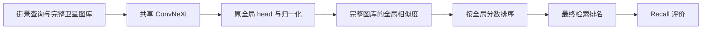
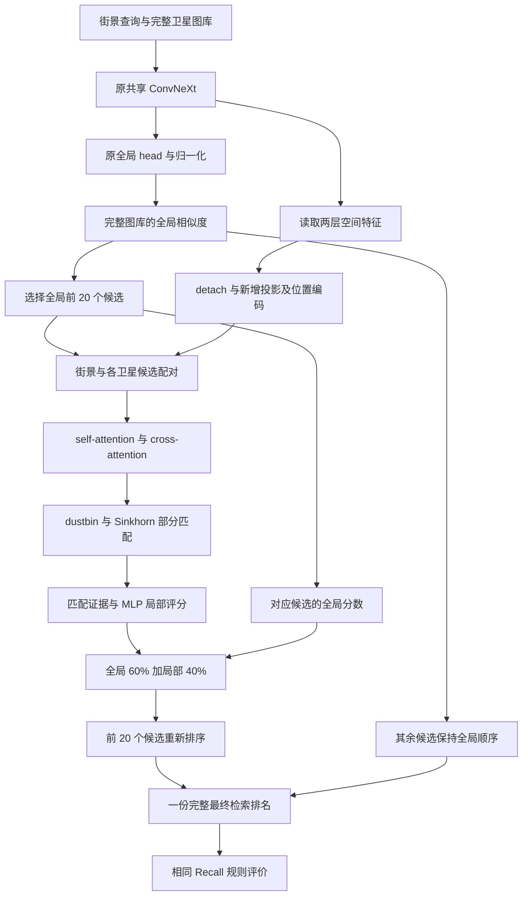
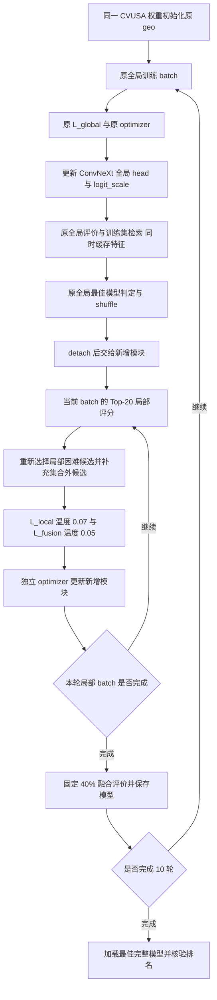

# Geo 第一次成功改进实验对比清单

日期：2026-11-15。比较对象为原 geo 复现与加入局部候选匹配的完整模型。改进模型的成绩均指全局与局部融合后的最终检索结果。

## 实验成绩

| 指标 | 原 geo | 改进实验一 | 增加的百分点 |
|---|---:|---:|---:|
| R@1 | 79.8059% | **84.2935%** | **4.4876** |
| R@5 | 97.8169% | 98.2414% | 0.4245 |
| R@10 | 98.9691% | 99.1510% | 0.1819 |
| R@1% | 99.5149% | 99.6968% | 0.1819 |
| 第一名正确数量 | 1316 / 1649 | 1390 / 1649 | 增加 74 个 |
| 第一名错误数量 | 333 / 1649 | 259 / 1649 | 减少 74 个 |

R@1 表示正确图片排在第一名的查询比例；R@5、R@10 分别表示正确图片进入前 5、前 10 的比例，R@1% 在本图库中对应前 16。

R@1 的直接差值为 **4.4876 个百分点**；增加量除以原成绩得到相对提高 **5.6231%**。汇报准确率采用“从 79.8059% 提高至 84.2935%，提高 4.4876 个百分点”的表述。

| 原 geo 的判断 | 改进后正确 | 改进后错误 | 合计 |
|---|---:|---:|---:|
| 原先正确 | 保留 1293 个 | 新增错误 23 个 | 1316 |
| 原先错误 | 纠正 97 个 | 仍然错误 236 个 | 333 |
| 合计 | 1390 | 259 | 1649 |

单独核验全局分支时，其四项 Recall 均与原 geo 相同。局部模块贡献体现在最终排名变化：纠正 97 个错误，同时新增 23 个错误，净增加 74 个正确查询。

## 改进内容

| 改进 | 具体做法 | 作用 |
|---|---|---|
| 保留原有全局能力 | 原 ConvNeXt、全局 head 与 `logit_scale` 继续只接受原 `L_global` 的梯度 | 保持原 geo 的全局训练过程 |
| 读取两层空间特征 | 读取 `stages[2]` 和 `stages[3]`，经过 `detach`、聚合、投影与拼接 | 向新增模块提供图片内位置与内容信息 |
| 候选对交互 | 两组 self-attention、cross-attention，共四层 | 比较当前街景与具体卫星候选之间的局部信息 |
| 允许未匹配区域 | 匹配矩阵加入 dustbin，通过 Sinkhorn 求解部分分配 | 允许图片中的部分区域缺少对应位置 |
| 学习局部评分 | 汇总匹配内容差异、乘积及六项匹配统计量，经过 MLP 输出分数 | 学习区分正确地点与相似错误地点 |
| 困难候选训练 | 同时使用全局高分错误、局部高分错误和随机错误候选；局部困难候选每个 batch 更新 | 训练局部区分当前容易混淆的候选 |
| 独立局部与融合损失 | 新增参数使用 `0.5L_local+0.5L_fusion`，温度分别固定为 0.07、0.05 | 同时训练局部评分能力和最终融合排序 |
| 固定比例重新排序 | 从第一次融合计算起固定全局 60%、局部 40%，重新排序全局前 20 个候选 | 将局部判断用于最终检索结果 |

dustbin 和匹配矩阵通过图片配对标签学习。其检索收益由完整实验评价，矩阵不能直接解释为已经验证的真实几何对应。

## 保持相同的训练与评价参数

| 项目 | 原 geo | 改进实验一 |
|---|---|---|
| 数据集 | CVIAN | 相同 |
| 训练与测试划分 | `train_60.csv`、`val_60.csv` | 相同清单，SHA256 核验一致 |
| 训练图片对 | 2472 | 2472 |
| 测试查询与卫星图库 | 1649 个查询、1649 张卫星图片 | 相同，全部计入评价 |
| 原模型 | `convnext_base.fb_in22k_ft_in1k_384` | 相同的原模型 |
| 原有参数初始权重 | CVUSA `weights_e40_98.6830.pth` | 相同文件，SHA256 核验一致 |
| 全局输出维度 | 1024 | 1024 |
| 输入尺寸 | 街景 140×768，卫星 384×384 | 相同 |
| 街景裁剪行区间 | 训练 `[160:350]`，评价 `[160:360]` | 相同 |
| 图像处理 | 原 Dataset、缩放、插值与 mean/std | 相同 |
| 配对增强 | 翻转概率 0.5，旋转概率 0.75 | 相同 |
| seed、训练轮数 | 42、10 | 相同 |
| 原全局 batch、图片评价 batch | 64、128 | 相同 |
| 全局损失 | 原双向 InfoNCE，label smoothing 0.1 | 相同 |
| 全局温度 | 原可训练 `logit_scale` | 保持原学习方式 |
| 全局 optimizer | AdamW，LR 5e-4，betas 0.9/0.999，eps 1e-8，weight decay 0.01 | 相同 |
| 全局调度 | cosine，warmup 39 步，总计划 390 步 | 相同；实际执行 380 个全局 batch |
| 全局 AMP 与裁剪 | GradScaler 初始 1024，unscale 后逐元素裁剪 100 | 相同 |
| 全局采样 | 相似度采样，`neighbour_select=64`、`neighbour_range=128` | 沿用原有采样与图片 batch 生成流程 |
| Recall 计算 | 正确图片前方严格更高分候选的数量决定排名 | 相同规则 |
| R@1% | `floor(1649/100)=16` | 相同 |
| 模型选择 | 根据每轮测试 R@1 选择最佳模型 | 根据最终融合测试 R@1 选择最佳模型，本次为第 10 轮 |

两种方法使用相同的正确配对标签。新增模型从完整图库取得全局前 20 个候选，其余候选继续保留全局顺序；正确图片未进入前 20 的查询仍参与完整评价。

原采样保留完整 batch，本次每轮执行 38 个全局 batch，10 轮共 380 个；warmup 39 步、总计划 390 步沿用首次 shuffle 前的原调度计数。新增模块单独执行 380 次更新。

## 新增分支参数

| 参数 | 原 geo | 改进实验一 |
|---|---|---|
| 新增参数初始化 | — | 独立初始化，`module_init_seed=42` |
| 空间输入 | 全局 head 聚合特征 | 额外读取 stages 2、3；原全局 head 保持原样 |
| 新增投影 | — | 两层各投影到 64 维，拼接为 128 维 |
| 位置数量 | — | 街景 4×24＝96，卫星 12×12＝144 |
| 位置编码 | — | `MLP(2,32,128)`，另加视角 embedding |
| attention | — | 4 层，128 维，4 heads，FFN 隐藏维度 256 |
| 新增归一化与激活 | — | Pre-LayerNorm，eps 1e-5；FFN 使用 GELU |
| 新增查询 batch | — | 每个 batch 64 个查询 |
| 候选对分组 | — | 每组 16 对，启用 activation checkpointing |
| 特征缓存 | — | 每轮读取原全局前向中的空间输出，使用 FP32 保存 |
| 部分匹配矩阵 | — | 96×144，加入 dustbin 后为 97×145 |
| 匹配温度 | — | 固定 0.1 |
| Sinkhorn 停止条件 | — | 最少 30 次，每 10 次检查；全部候选对最大行列误差≤1e-3 时结束，最多 500 次 |
| 局部评分 | — | 262 维证据→64→1，末端 Tanh |
| 局部训练列表 | — | 正确 1、全局困难 4、局部困难 4、随机错误 3，共 12 个唯一候选 |
| 局部困难候选选择 | — | 每个 batch 在全局 Top-20 内按当前局部分数重新选择 |
| 融合训练候选 | — | 全局 Top-20；正确图片进入集合的查询参与融合损失 |
| 新增损失系数 | — | `lambda_local=0.5`、`lambda_fusion=0.5` |
| 局部损失温度 | — | 固定 0.07 |
| 融合损失温度 | — | 固定 0.05 |
| 新增 optimizer | — | 独立 AdamW，LR 5e-4；常规参数 weight decay 0.01，`bin_score` 为 0 |
| 更新与随机状态 | — | 新增模块独立管理 optimizer、scheduler、GradScaler 和随机状态 |
| 融合权重 | 全局分数直接排序 | 全局 0.6、局部 0.4，全程固定 |

局部损失和融合损失的温度仅用于训练。推理仍直接使用 `s_final=0.6s_global+0.4s_local`，新增参数通过学习改变局部分数。

## 检索流程对比

| 步骤 | 原 geo | 改进实验一 |
|---|---|---|
| 提取特征 | 提取查询与图库的全局向量 | 保留相同全局向量，并读取空间特征 |
| 初始检索 | 计算完整图库的全局相似度 | 相同 |
| 局部判断 | — | 对每个查询的前 20 个候选计算局部匹配分数 |
| 最终评分 | `s_global` | `0.6s_global+0.4s_local` |
| 最终排名 | 按全局相似度排序 | 前 20 个候选按融合分数排序，其余保持全局顺序 |
| 输出与评价 | 一份检索排名，计算 Recall | 一份最终融合排名，使用相同 Recall 规则 |

### 原 geo 检索流程图

### 改进模型检索流程图

## 训练流程与参数更新

| 过程 | 原 geo | 改进实验一 |
|---|---|---|
| 初始化 | 加载 CVUSA 权重 | 原有参数加载同一权重，新增参数独立初始化 |
| 每轮全局训练 | 原图像 batch、InfoNCE 与原 optimizer | 相同 |
| 全局评价与采样 | 全局测试评价、训练图库检索、最佳模型判定、shuffle | 保持原顺序，并缓存空间输出 |
| 新增训练 | — | 固定本轮全局参数和缓存，执行一轮局部模块训练 |
| 每个局部 batch | — | 当前 Top-20 评分→选择局部困难候选→计算两个新增损失→更新新增参数 |
| 每轮最终评价 | 全局检索评价 | 全局检索后进行局部融合评价，保存最佳完整模型 |
| 下一轮 | 继续原全局训练 | 继续原全局状态；原有采样、调度和随机状态独立保存 |

原全局特征进入新增训练前执行 `detach`，融合损失中的全局分数也执行 `detach`。新增损失更新局部模块自己的投影、位置编码、attention、匹配与评分参数。每轮局部训练前后，程序核验原全局参数及 buffer 指纹保持相同。

## 实验依据与结论范围

| 项目 | 记录 |
|---|---|
| 原 geo 复现作业 | `3979539` |
| 改进实验一作业 | `4316915`，节点 g0177，退出码 0:0 |
| 训练源码提交 | `591f31003f01977beb6c21e6ee6163d8b56ea81f` |
| 最佳模型 | 第 10 轮 `best_fusion.pth` |
| 本次资源与耗时 | 两张 A100，8 个 CPU，03:22:53 |
| 训练检查 | 380 次新增模块更新，无混合精度跳过更新；训练匹配检查全部收敛，最多 60 次迭代 |
| 保存加载核验 | 最佳模型重新加载后排名一致 |
| 全局保护核验 | 原全局四项 Recall 与复现相同，每轮新增训练前后原参数指纹相同 |

本次是相同数据划分、seed 42 下的一次完整改进实验，证明这一组新增结构与训练设置能够改善最终检索。固定融合、独立温度和逐 batch 候选选择共同参与本次训练，各模块的独立贡献需要消融比较。最佳轮次和部分参数选择参考测试集成绩，报告保留该评价协议说明。

## 后续查看入口

- [完整实验方案](实验方案.md)：后续改动的设计依据。
- [本次作业记录](records/Geo_fixed40_4316915.md)：源码版本、原始参数、服务器路径和 checkpoint SHA256。
- [当前训练配置](../configs/geo_partial_match_fixed40.json)：实际参数。
- [最终结果数据](../results/4316915/result.json)：完整精度数值、纠错计数及模型标识。
- [本地结果文件说明](../results/4316915/README.md)：每轮指标、环境与逐查询分数的用途。
